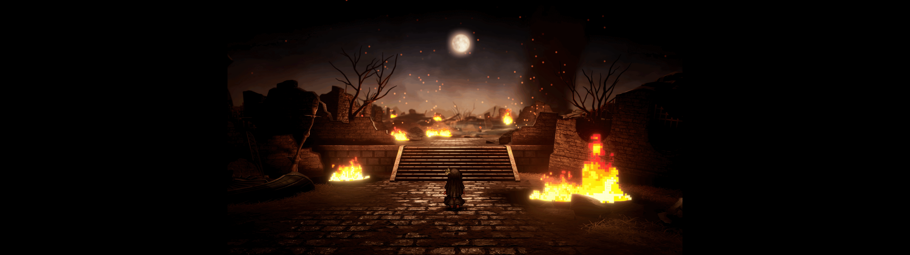
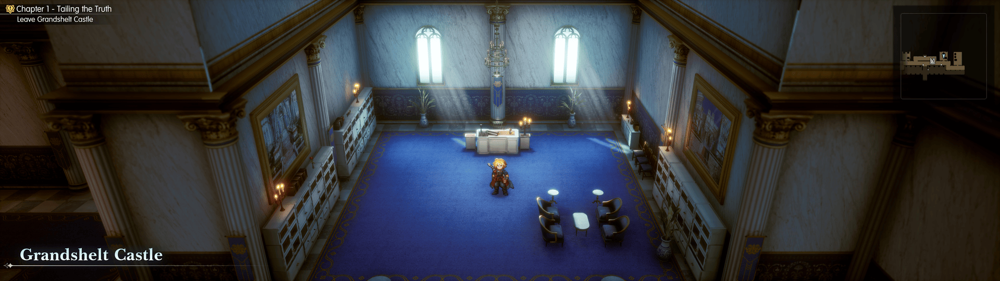

# FINAL FANTASY RESONANCE Fix


***This project is designed exclusively for Windows due to its reliance on Windows-specific APIs.***

## Fixes
- Remove black bars in ultrawide resolutions
- Movies are constrained to their original 16:9 format
- Game keeps running when its window loses focus
- Add ability to constrain HUD
- Add ability to configure various post processing effects
- Add ability to load and use a custom font

## Build and Install
Requires:
- [Rust](https://www.rust-lang.org/tools/install)
- [Python 3](https://www.python.org/downloads/) for the install scripts (optional, see [Using cargo directly](#using-cargo-directly))

1. Clone:
```ps1
git clone https://github.com/PolarWizard/final-fantasy-resonance-fix.git
cd final-fantasy-resonance-fix
```
2. Install [Ultimate ASI Loader](https://github.com/ThirteenAG/Ultimate-ASI-Loader) into the game folder (only needed once):
```ps1
python scripts/loader.py "<path to 'FINAL FANTASY RESONANCE\FFRS\Binaries\Win64' folder>"
```
3. Build and install the fix:
```ps1
python scripts/install.py "<path to 'FINAL FANTASY RESONANCE\FFRS\Binaries\Win64' folder>"
```
This builds a release DLL with `cargo` and copies it to `<game folder>/scripts/final_fantasy_resonance_fix.asi`, along with a default config on first install. Pass `--debug` to build and install a debug build instead.

If you're using VS Code, the same steps are wired up as tasks in `.vscode/tasks.json` (`loader`, `install`, `build and install`) -- edit the game folder path in there to match your install first.

### Using cargo directly
The scripts are optional; without Python, do the same steps by hand:
1. Install the ASI loader (only needed once): download `winmm-x64.zip` from the [Ultimate ASI Loader releases](https://github.com/ThirteenAG/Ultimate-ASI-Loader/releases) and extract `winmm.dll` into `FINAL FANTASY RESONANCE\FFRS\Binaries\Win64`, next to `FFRS-Win64-Shipping.exe`.
2. Build the fix:
```ps1
cargo build --release
```
3. Copy `target\release\final_fantasy_resonance_fix.dll` into `FINAL FANTASY RESONANCE\FFRS\Binaries\Win64\scripts` (create the `scripts` folder if it doesn't exist) and rename it to `final_fantasy_resonance_fix.asi`.
4. On first install, also copy `final_fantasy_resonance_fix.toml` into that `scripts` folder. Afterwards keep the copy that's there, since it holds your settings.

For a debug build, use `cargo build` and copy from `target\debug` instead.

## Configuration
- Edit `<game folder>/scripts/final_fantasy_resonance_fix.toml`

## Screenshots
| Ultrawide |
| :---: |
|  |
| Fix disabled → Fix enabled |

| HUD Constraining |
| :---: |
|  |
| 32:9 → 21:9 → 16:9 |

## License
Distributed under the MIT License. See [LICENSE](LICENSE) for more information. Third-party license text for every dependency can be generated with `python scripts/licenses.py`, which writes it out to `LICENSES`.

## Special Thanks
- Thank you [Encryqed](https://github.com/Encryqed) for [Dumper-7](https://github.com/Encryqed/Dumper-7)! The Rust SDK was generated with [my custom fork](https://github.com/PolarWizard/Dumper-7/tree/rust-sdk-generator).
